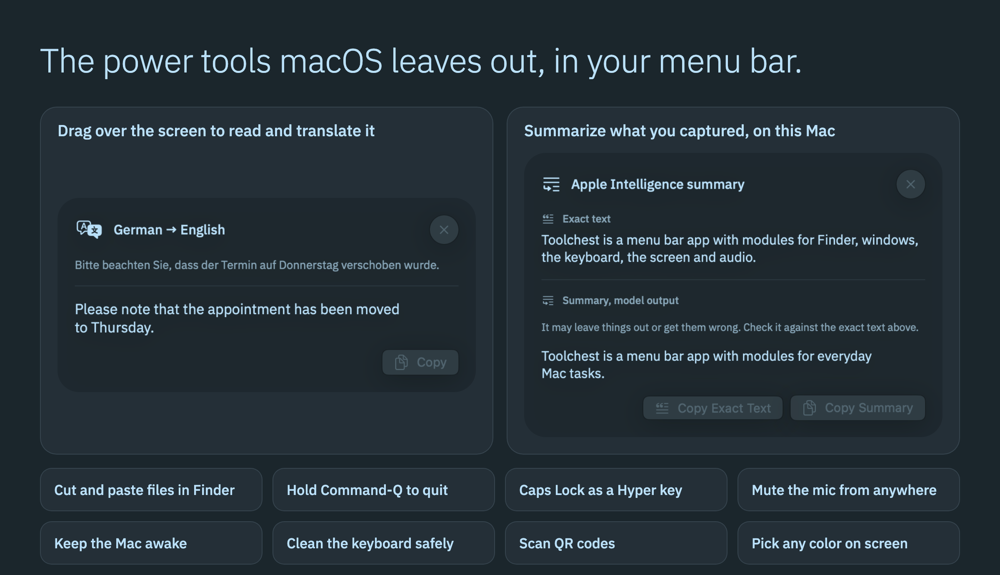
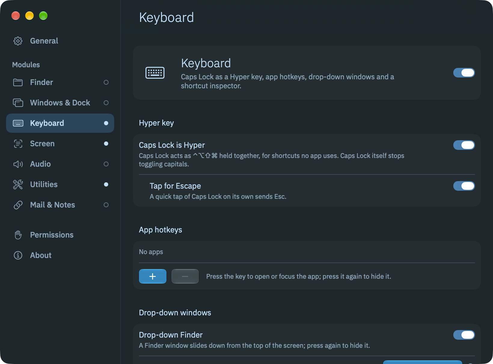
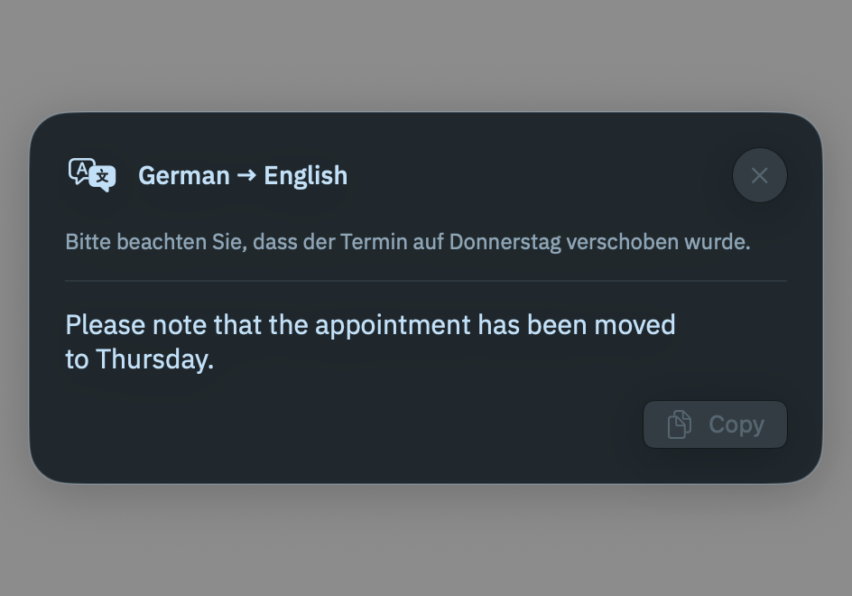
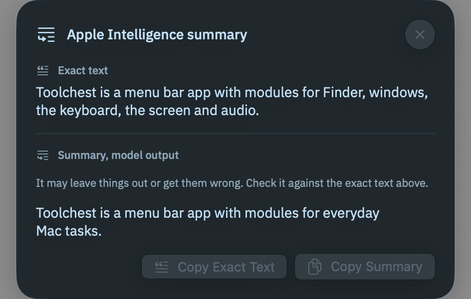
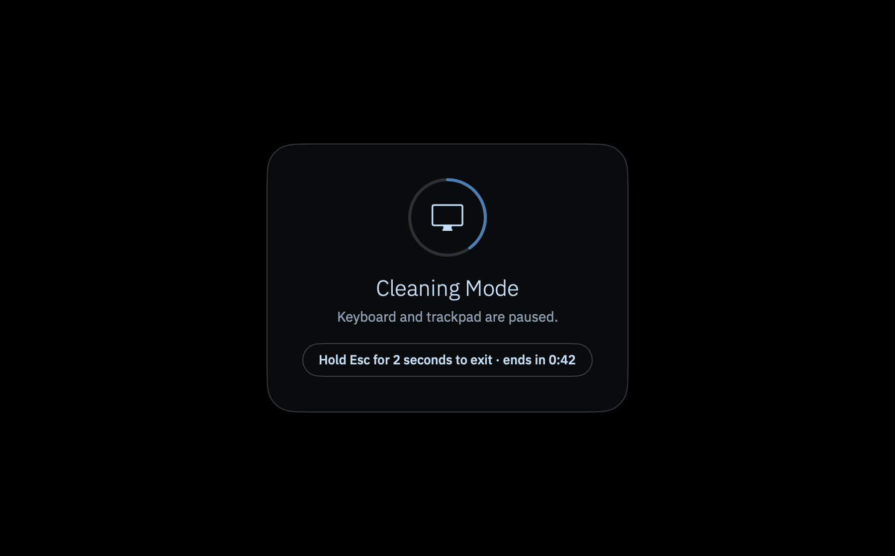
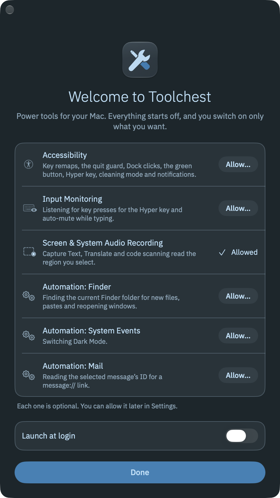

# Toolchest

[](https://github.com/gabrimatic/toolchest/releases/latest)
[](LICENSE)
[]()
[]()
[]()

**Power tools for your Mac, in the menu bar. Every one switches on and off on its own.**

Toolchest is a free menu bar app for anyone who wants what macOS leaves out: cut and paste files in Finder, a quit guard for Command-Q, Caps Lock as a Hyper key, text from any region of the screen, a mic mute you can reach from anywhere, Keep Awake, a cleaning mode. Nothing changes how your Mac behaves until you turn it on. No account, no network, no telemetry.

[Website](https://gabrimatic.github.io/toolchest/) · [Download](https://github.com/gabrimatic/toolchest/releases/latest) · [Contributing](CONTRIBUTING.md) · [Security](SECURITY.md)

<p align="center">
  
</p>

## Install

One line. It downloads the latest release, checks its SHA-256 against `SHA256SUMS.txt`, installs to `/Applications` and opens Toolchest:

```bash
curl -fsSL https://raw.githubusercontent.com/gabrimatic/toolchest/main/install.sh | bash
```

To read it first: [install.sh](install.sh). Options: `--no-open`, `TOOLCHEST_VERSION=1.0.0`, `TOOLCHEST_INSTALL_DIR=$HOME/Applications`.

Or download `Toolchest-<version>.dmg` (or the `.zip`) from [Releases](https://github.com/gabrimatic/toolchest/releases/latest) and drag Toolchest to Applications.

### First Open

Toolchest is free and open source. Release builds are signed ad hoc, not notarized, so macOS blocks the first open of a copy you downloaded in a browser. `install.sh` does not hit this.

1. Open Toolchest. macOS says it cannot verify the app. Choose **Done**.
2. Open **System Settings > Privacy & Security** and scroll to **Security**.
3. Next to the note that Toolchest was blocked, click **Open Anyway** and confirm.

You do this once per download. Because the signature is ad hoc, macOS can treat a new version as a new app: if a permission stops working after an update, switch Toolchest off and on in that list.

## What It Does

Toolchest has seven modules. Each has its own switch, with one switch per feature inside it, and a feature runs only while both are on.

| Module | What it does |
| --- | --- |
| [Finder](#finder) | Cut and paste files, Return to open, reopen closed windows, new files and right-click extras |
| [Windows & Dock](#windows--dock) | Quit guard, isolate a window, Dock clicks and a green button that fills the screen |
| [Keyboard](#keyboard) | Caps Lock as a Hyper key, app hotkeys, drop-down windows and a Shortcut Inspector |
| [Screen](#screen) | Copy text from anywhere, translate it, summarize it, scan codes and pick colors |
| [Audio](#audio) | Keep Music shut, mute the mic, switch devices and cap the volume after wake |
| [Utilities](#utilities) | Keep Awake, Cleaning Mode, quick toggles, clipboard clearing and notification shortcuts |
| [Mail & Notes](#mail--notes) | Copy a link to the selected message or note |

On top of those: [25 Shortcuts actions, a Focus filter, Control Center controls and desktop widgets](#shortcuts-focus-controls-and-widgets).

| | |
|---|---|
|  |  |
| **Settings.** One pane per module, one switch per feature. | **Capture and Translate.** Drag over any region; the translation opens beside the original. |
|  |  |
| **Capture and Summarize.** The exact text next to a labelled on-device summary. | **Cleaning Mode.** Wipe the keyboard and trackpad; hold Esc to leave. |

### Defaults

After the first launch only two things are on: **Keep Awake** (a menu bar submenu) and **Color Picker** (a menu item). Neither does anything until you use it, and no hotkey is registered. Turn on modules in Settings (menu bar icon > Settings…) or from the menu's **Modules** submenu.

Finder, Windows & Dock, Keyboard, Audio and Mail & Notes start off, and their features start on. Turning on one of these modules turns on everything inside it except `Mute while typing in a call`, so switch off what you don't want on its pane. Screen and Utilities start on with only Color Picker and Keep Awake; you switch on the rest one by one.

Seven hotkeys come suggested, ⌃⌥⌘ plus a letter: Isolate window (I), Capture Text (T), Capture and Translate (Y), code scanning (B), Mic mute (M), next output (O), next input (U). The others start empty until you record one. A hotkey registers only while its feature is on. The recorder lists conflicts with macOS shortcuts, standard app commands (⌘Q, ⌘C…) and Toolchest's other hotkeys; Esc cancels recording, Delete clears. If another app holds a combination, Settings > General says so.

### Finder

- `Cut and paste files`: ⌘X then ⌘V moves files. ⌘X becomes ⌘C and is remembered as a cut; ⌘V becomes ⌘⌥V (Move Item Here) only while the clipboard still holds those files. Only in Finder's file list, never in a text field (rename, search, Go to Folder).
- `Return opens, F2 renames`: Return becomes ⌘↓; F2 becomes Return. On Mac keyboards F2 needs fn unless "Use F1, F2… as standard function keys" is on.
- `Reopen closed window`: ⇧⌘T reopens the last closed Finder window or tab (up to 20, newest first, skipping deleted folders). It replaces Finder's own ⇧⌘T (Show Tab Bar). Closes are tracked from ⌘W and from the red button; the folder opens the way Finder's "open folders in tabs" preference says.
- `New text file`: ⌥N creates `untitled.txt` (or `untitled 2.txt`…) in the current folder, selects it and starts renaming.
- `Paste image or text as a file`: ⌘V with an image or text and no files on the clipboard saves `Pasted Image <date>.png` or `Pasted Text <date>.txt`.
- `Right-click extras` (Finder extension "Toolchest Finder Extras"): Copy Path, Open in Warp (Terminal if Warp is missing), Open in VS Code (when installed), New File from Template… (templates live in `~/Library/Application Support/Toolchest/Templates`), Move To…, Copy To…, Color Tag, Name by Content…, Copy SHA-256, Remove Photo Location. Move and Copy never overwrite: a clash gets a numbered name.
- `Name by Content…`: the Apple Intelligence model on this Mac reads the selected files (text, Word, RTF, PDF, scans and images, up to 40 at a time) and proposes a real name for each, like `Northwind Invoice 8841 October 2026.txt`. You see every new name first, untick any you don't want and press Rename, and Undo puts them all back. Nothing leaves the Mac.
- `Remove Photo Location`: never edits the original. It writes `<name> (no location).<ext>` next to it, keeps every other tag (dates, camera, orientation) and checks the copy has no GPS before keeping it.

The extension is sandboxed and does only Copy Path itself. Everything else goes to the app over a private channel, a Mach message port plus a fresh 256-bit secret in an owner-only file, and web pages and sandboxed apps can reach neither. Toolchest has no URL scheme. The app then checks again that the module and feature are on, Finder is in front, and every path is in Finder's selection or the folder it shows. Files are never overwritten or written through a symlink. Details: [SECURITY.md](SECURITY.md).

### Windows & Dock

- `Hold ⌘Q to quit`: ⌘Q needs a hold (a ring fills next to the pointer; 0.6 s by default, 0.3 to 1.5 s in Settings) or a double press. Add apps under **Also guard ⌘W in** to give ⌘W the same guard. Finder and Toolchest are exempt.
- `Isolate window`: a hotkey hides every other app.
- `Click the active app's icon`: clicking the Dock icon of the app you are in hides it, minimizes its windows or cycles them (your choice).
- `Middle-click quits`: middle-click a Dock icon and hold, or click twice, to quit that app. Finder and Toolchest are exempt.
- `Green button fills the screen`: click it to fill the visible screen; click again to restore. ⌥-click enters full screen.

### Keyboard

- `Caps Lock is Hyper`: Caps Lock acts as ⌃⌥⇧⌘. Toolchest maps Caps Lock to F18 per keyboard (the `UserKeyMapping` property `hidutil` sets) and its event tap turns F18 into the four modifiers. Caps Lock stops toggling capitals while this is on.
- `Tap for Escape`: a quick lone tap of Caps Lock sends Esc.
- `App hotkeys`: a key opens or focuses an app; pressing it again hides it.
- `Drop-down Finder` and `Drop-down terminal`: a key brings Finder or Warp (Terminal if Warp is missing) to the top of the screen, 45% of its height by default (25% to 90% in Settings); press again to hide.
- `Shortcut Inspector`: record a shortcut and see which running apps have a menu item for it.

### Screen

- `Capture Text`: drag over any region (text, images, PDFs) and its text is copied. Vision, accurate mode, automatic language detection, on device.
- `Tidy captured text` (off by default): joins lines broken mid-sentence, removes line-end hyphens and extra spaces before copying. Plain rules, no AI, so text inside a screenshot can't steer it; it never adds, drops or changes a word.
- `Capture and Translate`: the same, then Apple's Translation on device, shown in a panel with Copy. **Translate into** takes the system language or one of 16 others. A language pair that is not downloaded yet shows the system download prompt.
- `Capture and Summarize` (Apple Intelligence): shows a summary labelled as model output next to the exact text, with separate Copy Exact Text and Copy Summary buttons. Model output is never put on the clipboard unless you press Copy Summary.
- `Scan QR codes and barcodes`: from a region or the clipboard image (**Scan Clipboard Image** in the menu). The result shows before anything opens, and only `http` and `https` links get an Open button.
- `Color Picker`: the system color sampler; copies Hex, RGB or OKLCH.

### Audio

- `Music stays shut`: when Music launches within 1.5 s of a media key, or with no click or key press in the 2 s before (headphones and Bluetooth play commands reach macOS without a key event), Toolchest quits that new Music process. A Music you open from the Dock, Finder, Spotlight or a terminal stays open.
- `Mic mute`: a hotkey and a menu bar indicator (click it to toggle) mute the default input through Core Audio. The mute follows you to a new default input.
- `Mute while typing in a call` (off by default): while the mic is in use, typing mutes it, and it unmutes 0.8 s after you stop.
- `Switch devices with a shortcut`: hotkeys cycle outputs and inputs in name order, with an on-screen card.
- `Cap volume after wake`: if the Mac wakes louder than the cap (50% by default), the volume drops to it.

### Utilities

- `Keep Awake`: a power assertion that stops idle display and system sleep for 15 min, 30 min, 1, 2 or 5 hours, or until turned off. The submenu lists Off and the lengths with a checkmark on the current choice; the running countdown sits under it. Its hotkey keeps the Mac awake until you press it again.
- `Cleaning Mode`: black overlay on every screen that swallows keyboard, trackpad, mouse and media keys. Hold Esc for 2 s to exit; it always ends after 60 s, and when the Mac sleeps or locks. The 60 s limit is enforced twice (a main-thread timer and the input gate itself, which lets every event through after the deadline even if the app stalls), the overlay ignores the mouse, and it refuses to start without Accessibility.
- `Dark Mode and desktop icons`: switch Dark Mode (through System Events) and show or hide desktop icons (Finder's `CreateDesktop`, which relaunches Finder) from the menu bar.
- `Clear the clipboard` (off by default): clears an item Toolchest saw being copied once it is older than the set age (30 s to 10 min), and on sleep or screen lock. It never clears while ⌘ is held or right after a paste, and never something copied after Toolchest's item.
- `Notification shortcuts`: hotkeys to clear all notifications or open the top one, through Notification Center's Accessibility tree.

### Mail & Notes

- `Copy message link`: copies a `message://` link to the selected message. Opening the link jumps to that message in Mail.
- `Copy note link`: Notes exposes no link through scripting, so Toolchest presses Notes' own Copy Link command for the selected note when Notes offers it.

Both only read from apps that are already open; Toolchest never launches Mail or Notes.

### Shortcuts, Focus, Controls and Widgets

- `Shortcuts and Spotlight`: 25 App Intents cover every module. An action whose module or feature is off stops and says which switch to turn on. Recognize Text in Image, Summarize Text and Translate Text work on what you hand them, with no screen capture and no switch. Siri knows ten actions ("Keep my Mac awake with Toolchest").
- `Focus filter`: add Toolchest to a Focus in System Settings > Focus to mute the mic, guard ⌘Q in every app, or keep the Mac awake while it's on. Ending the Focus undoes only what the filter changed.
- `Controls` for Control Center and the menu bar: Keep Awake, Mute Microphone, Next Output Device, Cleaning Mode, Hyper Key.
- `Widgets` for the desktop: Keep Awake (countdown and switch) and Audio Devices (output, input, mic mute button).

Controls and widgets live in a sandboxed extension that talks to the running app over the same kind of private channel as the Finder extension (its own port and secret). Turning on the Hyper Key control or action also turns on the Keyboard module. While Toolchest is not running, controls show off and widgets ask you to open it.

### App Windows and Menus

Toolchest is a menu bar app with no Dock icon, in any state. Its menu opens with the app's name, then the items of what you turned on, **Modules**, **Settings…** (⌘,), **About Toolchest** and **Quit Toolchest** (⌘Q).

While one of its windows is in front, the standard menus show: **Toolchest**, **Edit** (so every text field works), **Window** and **Help**. **Toolchest Help** opens Settings > About, which has a **Using Toolchest** section. Esc closes About, the permission card and the result panels.

Settings has General, one pane per module, Permissions and About, and remembers its size and position. Opening Toolchest again from Finder or Spotlight shows the welcome window until you finish it, and Settings after that, so everything stays reachable even if you hide the menu bar icon. A second launch hands over to the running copy and quits.

Launch at login starts on: the first launch registers it, and the welcome window and Settings show the real state. To turn it off, use the switch in Settings > General or System Settings > General > Login Items & Extensions.

Quitting, `kill` included, puts back every system change Toolchest made: the key mapping, power assertions, overlays and the extension secrets.

### Look and Feel

- `Haptic feedback` (Settings > General, on by default): a light Force Touch tap when a hold ring starts, a guarded quit fires, a region is picked, a module flips, a shortcut is recorded or Cleaning Mode ends. Only felt with a finger on the trackpad.
- Motion follows Reduce Motion: no springs, and drop-down windows appear at once. Low Power Mode and a hot Mac also skip the drop-down animation. Contrast follows Increase Contrast.
- Toolchest draws its own windows, cards and bars in [IBM Plex Sans](https://github.com/IBM/plex), Copyright © 2017 IBM Corp. with Reserved Font Name "Plex", bundled unmodified under the [SIL Open Font License 1.1](Resources/Fonts/OFL.txt). Native macOS controls keep the system font.

## Requirements

- macOS 26 or later
- A Mac with Apple silicon (M1 or later). There is no Intel build.
- Apple Intelligence turned on, only for Capture and Summarize, the Summarize Text action and Name by Content

## Permissions

Every permission is optional and belongs to the features that need it.

| Permission | Needed by |
| --- | --- |
| Accessibility | Finder keys, quit guard, Dock clicks, green button, Hyper key, mute while typing, clipboard clearing, Cleaning Mode, notification shortcuts, drop-down windows, note links, Shortcut Inspector |
| Input Monitoring | Hyper key and mute while typing (listening for key presses) |
| Screen & System Audio Recording | Capture Text, Capture and Translate, Capture and Summarize, code scanning from the screen |
| Automation: Finder | current folder for new files, pasted files and reopening windows; checking the selection for right-click extras |
| Automation: System Events | Dark Mode |
| Automation: Mail | Mail message links |
| Finder extension (Login Items & Extensions) | right-click extras |

**Welcome window.** The first launch opens a window with one row per permission, each with a live status and an **Allow…** button, then a **Launch at login** switch and **Done**. **Allow…** asks macOS through its own request API, so macOS adds Toolchest to the list and shows its prompt; you never press "+" in System Settings. After a refusal the button turns into **Open System Settings** for the exact pane. Each row reads **Allowed** the moment access arrives, with no relaunch. **Automation: Mail** can only be asked while Mail is open, because Toolchest never starts it.

<p align="center">
  
</p>

Done, Esc and the close button all end the welcome window the same way, and it never returns on its own. To see it again, use **Show Again** on the **Welcome window** row in Settings > Permissions. That also lets Toolchest ask macOS for each permission again.

**At first need.** If a feature needs a permission that is missing, Toolchest asks macOS right then and waits until its prompt has been answered. If access is still missing, a card says so ("Cleaning Mode isn't allowed yet") with one button: **Allow…** if macOS was not able to ask, **Open System Settings** after a refusal. The card names the permission the way System Settings does and closes itself once access arrives. The feature pauses meanwhile (the menu shows "Needs Accessibility…"); it never half-works.

**Settings > Permissions** shows each permission's live state with the same buttons. Toolchest never flips a privacy switch itself.

**Finder extension.** The right-click menu needs Toolchest Finder Extras on in System Settings > General > Login Items & Extensions > Extensions > Finder, and the Finder module and Right-click extras on in Toolchest. **Turn On…** in Settings > Finder takes you there. If the menu stays missing, relaunch Finder: hold Option, right-click the Finder icon in the Dock and choose Relaunch.

## Privacy

Everything runs on your Mac. Toolchest makes no network calls and has no accounts, analytics or telemetry. Text recognition (Vision), translation (Apple Translation), summaries and naming files by content (Apple Intelligence) all run on device.

- Toolchest never records keystrokes or clipboard contents. Its event tap matches only the few key combinations of the features you turned on and passes everything else through untouched; it exists only while such a feature is on.
- Clearing the clipboard looks at the pasteboard change count, never at what was copied.
- Hotkeys use `RegisterEventHotKey`, which needs no permission and costs nothing while idle. Everything else is event-driven; no polling timers run while idle.
- Settings live in `~/Library/Preferences/info.gabrimatic.toolchest.plist`. Templates and the extension secrets (deleted on quit) live in `~/Library/Application Support/Toolchest`.

Trust boundaries: [SECURITY.md](SECURITY.md).

## Limits

- **Finder.** The current folder is the front Finder window's folder, or the Desktop when no window is open. Windows that show Recents, AirDrop or a search have no folder, so ⌥N and paste as file say so. Name by Content reads images and scanned PDFs on macOS 27; on macOS 26 it names files that hold text.
- **Windows & Dock.** Dock clicks are read through the Dock's Accessibility tree, so Dock folders and stacks are ignored. The green button covers windows whose button reports itself as a full-screen button; apps with a plain zoom button keep their behavior. Some apps limit their own window size.
- **Keyboard.** The Caps Lock mapping lives until reboot. Toolchest adds only its own entry and keeps your mappings of other keys. It removes the entry when the feature turns off, when Toolchest quits, and on the next launch after a crash, and applies it again when a keyboard connects or the Mac wakes. Windows cannot be placed above the menu bar, so a drop-down grows from under it. The Shortcut Inspector sees menu items only: shortcuts an app handles without a menu item, items an app adds only while a menu is open, and other apps' global hotkeys are invisible to it.
- **Screen.** Translation covers the pairs Apple's Translation supports, and the Translate Text action needs the pair downloaded already.
- **Audio.** The Music check is a timing heuristic; a launch with no input at all (Siri, a Shortcut, a script) is treated as automatic. Devices without a settable mute control can't be muted, and Toolchest says so.
- **Utilities.** Notification shortcuts reach notifications currently on screen (or with Notification Center open) and depend on the action names macOS exposes. Clipboard copies are noticed from ⌘C, ⌘X and clicks; something copied by a script without any input is not tracked, so it is never cleared.
- **Focus.** The filter keeps the Mac awake only while the Keep Awake feature is on.
- **Left out on purpose.** Grayscale, Night Shift, True Tone and Low Power Mode switches have no public macOS API. Left out for safety: quitting idle apps, quit all apps, switching the default browser without the macOS prompt, AirDrop auto-accept or auto-move, archiving or renaming Downloads, private trackpad gestures, and exporting settings between Macs.

Every system capability Toolchest uses and the ones it leaves out: [docs/PLATFORM.md](docs/PLATFORM.md).

## Build from Source

Requirements: Xcode 27 or later (Swift 6).

```bash
git clone https://github.com/gabrimatic/toolchest.git
cd toolchest
./build.sh --install
```

`scripts/package.sh` builds the release files into `dist/`. Details: [CONTRIBUTING.md](CONTRIBUTING.md).

## Uninstall

1. Quit Toolchest from its menu bar icon. This puts back the Caps Lock mapping and every other change Toolchest made.
2. Delete Toolchest from Applications. The login item goes with the app.
3. Delete its settings and files:

```bash
defaults delete info.gabrimatic.toolchest
rm -rf "$HOME/Library/Application Support/Toolchest"
```

## Contributing

Bug reports, ideas and pull requests are welcome: [CONTRIBUTING.md](CONTRIBUTING.md). Everyone taking part follows the [Code of Conduct](CODE_OF_CONDUCT.md). Security reports go through [SECURITY.md](SECURITY.md).

## License

MIT. See [LICENSE](LICENSE).

## Trademarks

Apple, Mac, macOS, Finder, Mail, Notes, Music, Terminal, Spotlight, Siri, Shortcuts, Control Center, Apple Intelligence, Force Touch, Xcode and Swift are trademarks of Apple Inc., IBM and Plex are trademarks of International Business Machines Corporation, VS Code is a trademark of Microsoft Corporation, Warp and Buy Me A Coffee are trademarks of their owners, and Toolchest is independent of all of them.

---

Created by [Soroush Yousefpour](https://gabrimatic.info)

[](https://www.buymeacoffee.com/gabrimatic)
